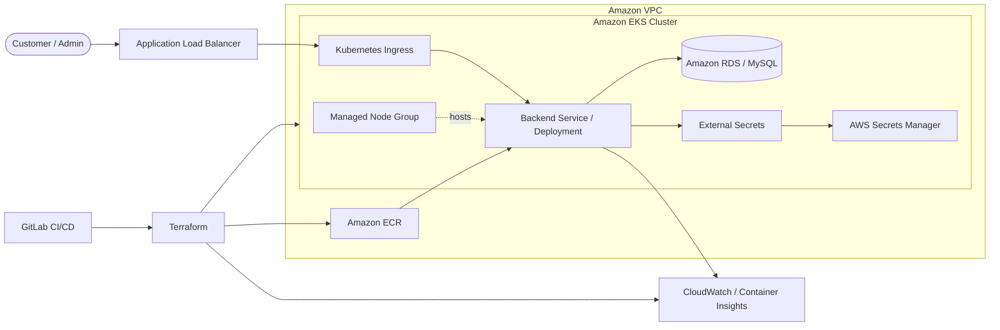

# AWS 3-Tier E-Commerce Backend Infrastructure with Terraform

[](https://www.terraform.io/) [](https://aws.amazon.com/) [](https://kubernetes.io/)

Terraform infrastructure for a containerized 3-tier e-commerce backend running on Amazon EKS. The project provisions the AWS foundation, configures Kubernetes integration, builds the Flask backend image, and deploys the workload through an automated CI/CD workflow.

> **Portfolio project:** This repository demonstrates Infrastructure as Code, container orchestration, IAM/OIDC integration, CI/CD automation, secret delivery, and operational monitoring. Review the security and cost notes before using it in an AWS account.

## Architecture



Source: [`docs/architecture.mmd`](docs/architecture.mmd).

## What this project demonstrates

- Terraform provisioning across AWS, Kubernetes, Helm, and TLS providers.
- VPC networking, EKS cluster and managed node group, ECR, IAM roles, OIDC, and security groups.
- AWS Load Balancer Controller and External Secrets integration.
- Dockerized Flask application delivery with Gunicorn.
- GitLab CI/CD from Terraform state bootstrap through image build and Kubernetes rollout.
- CloudWatch Container Insights and dashboard integration.

## Configuration

Copy `.env.example` to `.env` for local development. For deployment, provide Terraform variables through a private `.tfvars` file or protected CI/CD variables. Required deployment values include `aws_region`, `cluster_name`, `rds_endpoint`, `rds_secret_name`, `app_secret_name`, `frontend_url`, `backend_repo`, and `image_tag`.

Secrets must be stored in AWS Secrets Manager or a protected CI/CD secret store. Never commit `.env`, AWS keys, passwords, JWT secrets, or Terraform state.

## Deployment workflow

```bash
terraform init -backend-config="bucket=<versioned-state-bucket>" -backend-config="region=<aws-region>"
terraform fmt -check -recursive
terraform validate
terraform plan -var-file="<private-environment>.tfvars"
terraform apply -var-file="<private-environment>.tfvars"
```

The CI/CD workflow validates AWS access, bootstraps encrypted/versioned S3 state, applies infrastructure, builds and pushes the backend image to ECR, updates Kubernetes resources, and waits for rollout completion.

## Backend application

The Flask service includes authentication, product and order APIs, admin APIs, CORS controls, rate limiting, security headers, MySQL connectivity, health endpoints, and Gunicorn-based serving.

## Security and cost notes

This is a learning/portfolio project. Before production use, use short-lived AWS OIDC credentials, private subnets, least-privilege IAM policies, immutable image tags, a protected state bucket, environment-specific state, and approved change controls. Review reconciliation/cleanup logic before running it against shared AWS resources. EKS, EC2, RDS, load balancers, CloudWatch, and ECR can incur charges.

## Related repositories

- [AWS 3-Tier Terraform Frontend](https://github.com/pavan-007-0/aws-3tier-terraform-frontend)
- [AWS 3-Tier CFT Backend](https://github.com/pavan-007-0/aws-3tier-cft-backend)
- [AWS 3-Tier CFT Frontend](https://github.com/pavan-007-0/aws-3tier-cft-frontend)
