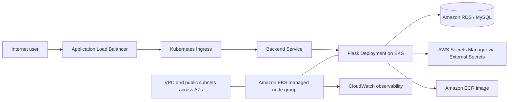

# AWS 3-Tier E-Commerce Backend on Amazon EKS with Terraform

[](https://developer.hashicorp.com/terraform)
[](https://aws.amazon.com/)
[](https://kubernetes.io/)
[](https://docs.gitlab.com/ee/ci/)

Terraform/HCL infrastructure for the backend tier of a containerized 3-tier e-commerce platform running on Amazon EKS.

> **Authoring model:** AWS, Kubernetes, Helm, IAM/OIDC, ECR, and CloudWatch resources are declared in Terraform/HCL. The GitLab pipeline automates validation, Terraform state initialization, infrastructure reconciliation, image delivery, and Kubernetes rollout.

## Architecture



## What is authored in HCL

- VPC, Internet Gateway, subnets, routes, and security groups
- Amazon EKS cluster and managed node group
- ECR repository and image settings
- IAM roles, policy attachments, and EKS OIDC provider
- AWS Load Balancer Controller and External Secrets Operator integration
- Kubernetes namespace, Deployment, Service, and Ingress resources
- Helm releases and EKS add-ons
- RDS network access integration
- CloudWatch observability add-on and dashboard
- S3 remote Terraform state configuration

## Repository structure

```text
main.tf              # Terraform/HCL providers, variables, AWS and Kubernetes resources
Dockerfile            # Flask backend container image
requirements.txt      # Python dependencies
*.py                  # Flask application modules
.gitlab-ci.yml        # GitLab CI/CD automation
README.md             # Architecture and operating notes
```

## Delivery workflow

1. GitLab CI validates AWS access and Terraform formatting.
2. The pipeline creates or reuses the S3 remote-state bucket.
3. Terraform initializes against the remote backend.
4. Terraform applies AWS, Kubernetes, Helm, and observability resources.
5. The backend image is built and pushed to Amazon ECR.
6. The EKS Deployment is updated with the commit image tag.
7. Kubernetes rollout status and the backend Ingress hostname are reported.

## Technology keywords

`Terraform` · `HCL` · `Amazon EKS` · `Kubernetes` · `Helm` · `Amazon ECR` · `Amazon RDS` · `AWS IAM` · `OIDC` · `Secrets Manager` · `External Secrets Operator` · `AWS Load Balancer Controller` · `CloudWatch` · `Docker` · `Flask` · `GitLab CI/CD`

## Configuration and safety

Use environment-specific Terraform variables and protected GitLab CI/CD variables. Do not commit credentials, `.env` files, Terraform state, database passwords, or generated logs. Review every plan before applying it to a shared AWS account. EKS, RDS, load balancers, CloudWatch, and ECR can incur charges.

## Related repositories

- [Terraform frontend](https://github.com/pavan-007-0/aws-3tier-terraform-frontend)
- [EKS YAML backend](https://github.com/pavan-007-0/aws-3tier-cft-backend)
- [EKS YAML frontend](https://github.com/pavan-007-0/aws-3tier-cft-frontend)
- ECS/CloudFormation repositories are documented separately under the `aws-3tier-cloudformation-ecs-*` naming convention.
